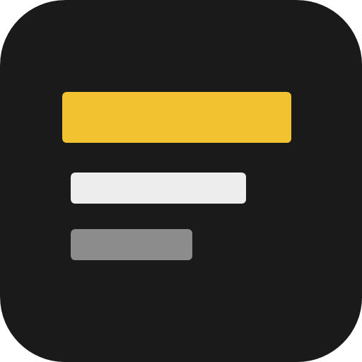
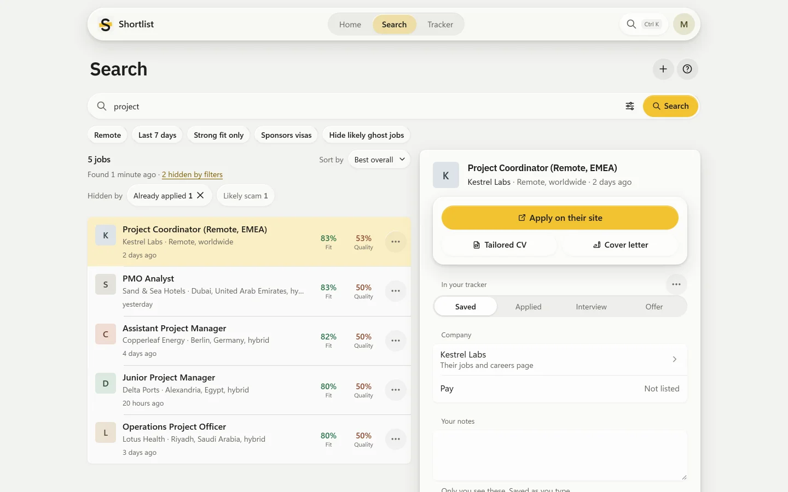
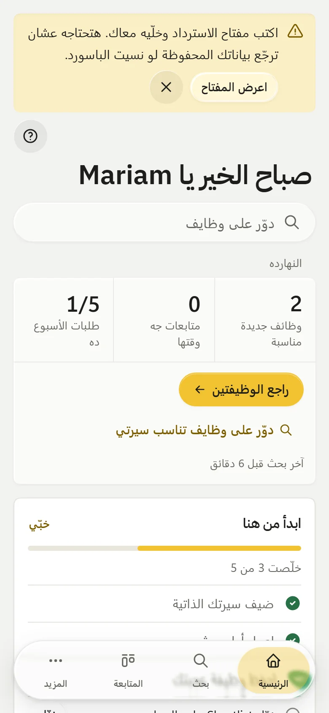
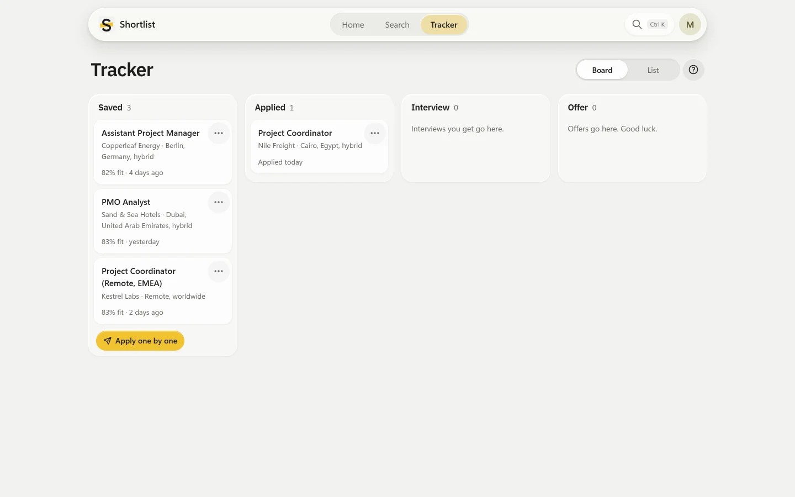
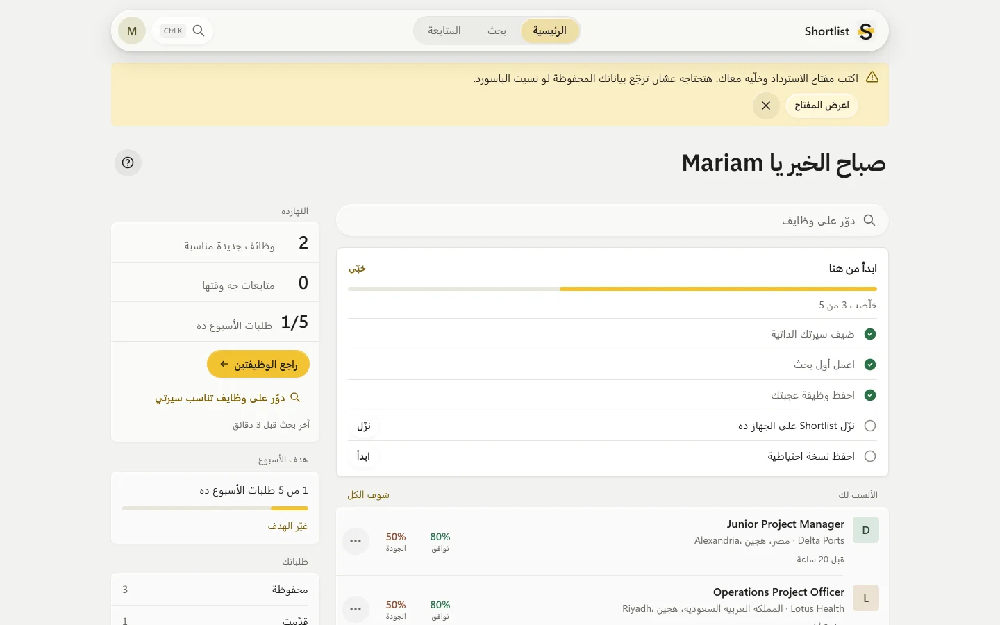
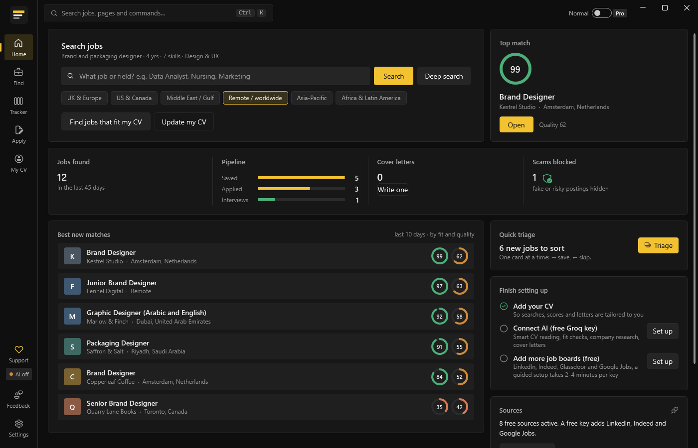

<h1 align="center">Shortlist</h1>

<b>Find jobs that actually fit you, and skip the scams.</b> 
Shortlist searches many job sites at once, scores every job against your CV, warns you about scams and ghost jobs, and helps you apply. Free, no ads, in English and Arabic.

  

  <b>The website is live: <a href="https://shortlistjobs.pages.dev/?utm_source=github">shortlistjobs.pages.dev</a></b>. It works on any phone or computer, and new features come there. 
  The Windows app is finished and still available from the <a href="https://apps.microsoft.com/detail/9NRGX29423RB?mode=direct">Microsoft Store</a> (details <a href="#the-windows-app">below</a>).

| Search: every job scored for fit and quality | Home on a phone, in Arabic |
|---|---|
|  |  |
| **Tracker: every application in one place** | **Home on a computer, in Arabic** |
|  |  |

Screenshots use a made-up account.

---

## The Windows app

Shortlist started as a free Windows app, and it's still on the Microsoft Store. It needs no account and keeps everything on your PC, checks your saved searches from the tray and sends a Windows notification for strong matches. It's in English only, for Windows 10 and 11. The two don't share data.

**The Windows app is finished.** Version 1.1.6 (November 2026) is its last update. It keeps working, but it won't get new features or fixes. Everything new goes to the website.

  
  &nbsp;
  

The rest of this page describes the Windows app.

## Why I built it

Hi, I'm Bishoy, a business graduate from Cairo trying to start a career in project management, ideally abroad. **I haven't found a job yet.** Like many of you, I spent hours on a dozen sites, got messages from fake "recruiters" asking for fees, and applied to ads that had been up for months with nobody on the other end.

So I built the tool I wished I had: one place that searches everywhere, tells you honestly how well a job fits you, and warns you before you waste your time or money. Finding, checking and tracking jobs in Shortlist is free, and that stays free.

I'm still looking too. **Let's find our jobs together.**

## What it does

- **One search, many job sites.** LinkedIn, Indeed and Glassdoor (with a free key), plus Adzuna, Google Jobs, Reed, remote-job boards and companies' own career pages. Search by job title or by a whole field, like "Data & Analytics".
- **Deep search.** Runs for a few minutes and finds many more jobs, trying related titles and companies that hire in your field.
- **Two scores for every job:**
  - **Fit:** how well it matches your CV, experience, location and visa needs.
  - **Quality:** pay, employer reputation, benefits and freshness.
- **Scam shield.** Warns about upfront fees, chat-app-only "recruiters", too-good-to-be-true pay and brand-new websites.
- **Ghost-job detector.** Spots ads that are reposted again and again, have stayed up for months, or are only "collecting CVs".
- **Community warnings.** Report a scam or ghost job in one click. When several users report the same employer, everyone gets a warning.
- **Visa sponsorship.** Checks the job text and the official UK, Dutch and US sponsor lists.
- **Card Deck.** Go through new jobs one at a time: save, skip or apply.
- **Apply kit:**
  - Cover letters written from your real CV, and checked so nothing is made up.
  - A tailored CV for each job, with a keyword-match score before and after.
  - A **CV builder** that turns a simple form into a clean PDF or Word CV.
- **Job alerts.** Save a search and Shortlist checks for new jobs every few hours from the tray, then sends a Windows notification for strong matches. Alerts don't use your AI allowance.
- **Tracker.** Every application in one place: saved, applied, interview, offer. When an application gets no reply for a week, Shortlist reminds you and writes a short follow-up email you can copy.
- **Today and a weekly goal.** Home shows your next few steps and how many applications you sent this week.

## Install

1. **Easiest:** [get it from the Microsoft Store](https://apps.microsoft.com/detail/9NRGX29423RB?mode=direct) and press **Get**. No warning, and the Store keeps it updated.
   **Or** click **Download for Windows** above. It downloads `Shortlist-beta-Setup.exe` straight away. Run it.
   - Windows may show a warning the first time you run the GitHub download. That's expected for a new app; see [Why does Windows warn me?](#why-does-windows-warn-me)
2. Open Shortlist and follow the 3 quick steps: add your CV, choose where you want to work, see your matches. It works right away with 8 free job sources.
3. **Optional:** connect free AI from Groq when a feature asks for it. The app walks you through it in about 2 minutes. It turns on CV reading, fit checks and cover letters.

Updates download by themselves. A bar at the top tells you when one is ready, and it installs when you close Shortlist. The Store version is updated by the Microsoft Store.

## Microsoft Store

Shortlist is on the [Microsoft Store](https://apps.microsoft.com/detail/9NRGX29423RB?mode=direct) as **Shortlist: Job Search**. Microsoft checked and signed it, so it installs in one click with no warning, and the Store keeps it updated. It's the same free app as the GitHub download. If you already use the GitHub version, you don't need to switch.

## Why does Windows warn me?

When you download or open a new app, you may see one of these:

- **Your browser:** *"Shortlist-beta-Setup.exe isn't commonly downloaded"*. In Edge, click **...** then **Keep**, then **Keep anyway**. In Chrome, click **Keep**.
- **Windows:** a blue box, *"Windows protected your PC"*. Click **More info**, then **Run anyway**.

Why: Windows trusts apps that are code-signed with a paid certificate (a few hundred dollars a year) or that thousands of people have already downloaded. Shortlist is new and made by one person, so it has neither yet. The warning doesn't mean anything was found in the file.

How you can check it yourself: every release links a [VirusTotal](https://www.virustotal.com) scan of the installer in its notes. Or use the [Microsoft Store version](https://apps.microsoft.com/detail/9NRGX29423RB?mode=direct), which Microsoft checks and signs, so there's no warning at all.

## Your privacy

- **Your CV, searches, letters and API keys stay on your PC.** No account, no ads, and your data is never sold.
- Shortlist only sends what it needs: your searches go to job sites, and AI requests go to Groq with your own key. Scam and ghost reports you make, and feedback you send, go to the Shortlist community server.
- Anonymous crash reports and feature counts are **off until you switch them on**.
- You can delete everything from *Settings → Privacy & community*.

Full details are in the [privacy policy](PRIVACY.md).

## Feedback and help

Click **Feedback** in the left bar (or press **Ctrl+Shift+F**). Your message goes straight to my inbox. Leave your email if you'd like a reply. You can also [open an issue](https://github.com/BishoyRaafaf/shortlist-releases/issues).

## Support Shortlist

Shortlist is free and has no ads. If it helped you, you can **[support it here](https://shortlistjobs.pages.dev/support?utm_source=github)** with InstaPay from Egypt or Airtm from anywhere.

**Every supporter can have their name on the Supporters list on the website's [About page](https://shortlistjobs.pages.dev/about?utm_source=github).** Tell me the name on the support page after you send. You can also stay anonymous.

Can't donate? Telling a friend who's job hunting helps just as much.

## Wrongly flagged?

Community warnings are automatic. An employer is flagged only after several different users, on different networks, report it, and every warning in the app says it comes from user reports. If you represent an employer that was flagged by mistake, [open an issue](https://github.com/BishoyRaafaf/shortlist-releases/issues/new?template=wrongly_flagged.yml) or use the in-app Feedback form. Include the company name and website. I review every request and remove wrong flags quickly.

## About the developer

Shortlist is built by **Bishoy Raafat**, a business graduate in Cairo who's moving into project management, while job hunting himself. Say hi on [LinkedIn](https://www.linkedin.com/in/bishoy-raafat).

## Known issues

- The GitHub download may get a warning from Windows on install. See [Why does Windows warn me?](#why-does-windows-warn-me) The Microsoft Store version doesn't.
- The free AI plan has a daily limit. Shortlist tells you when it resets and keeps working without AI in the meantime. *Settings → AI usage → Light* saves the most.

---

Shortlist is in public beta and provided as is. © 2026 Bishoy Raafat. Free to use. The source code isn't public. See the [license](LICENSE).
